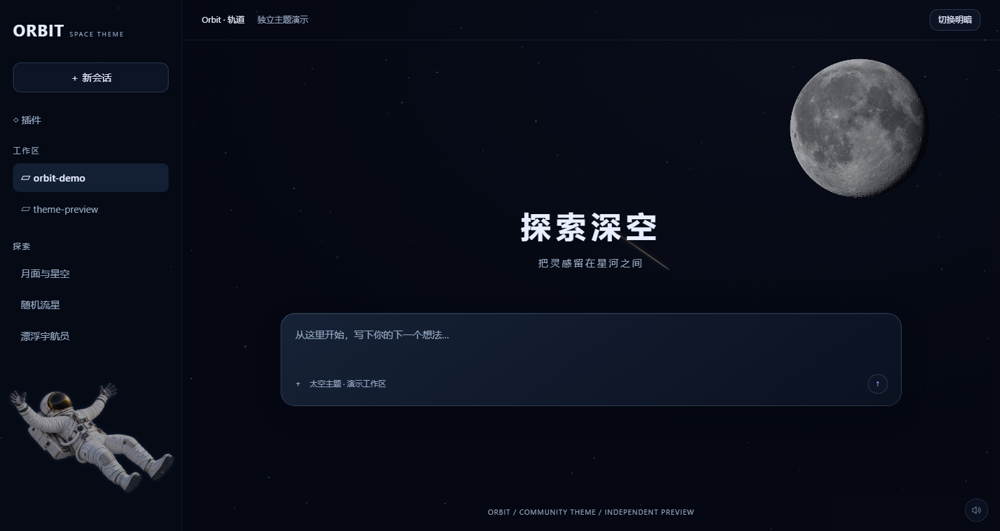
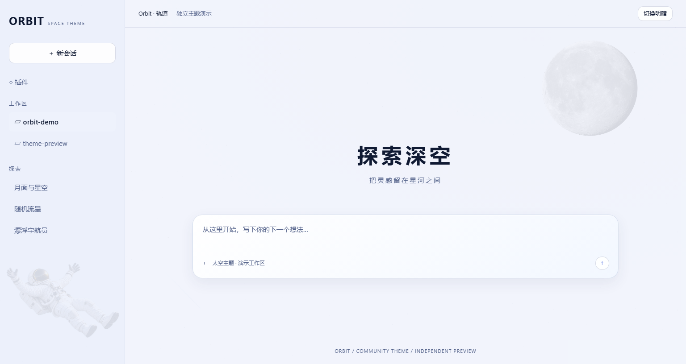
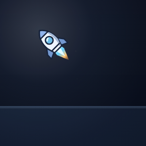

# Orbit · 轨道

给 **DeepSeek Harness（DSH）** 的开源太空主题：深色月球与漂浮宇航员、浅色太阳与燃烧骷髅、随机流星，以及只在 DSH 内生效的火箭鼠标指针。

[](LICENSE)

当前版本：[v0.3.0](https://github.com/ZcNCn39/dsh-theme-orbit/releases/tag/v0.3.0) · [更新记录](CHANGELOG.md)

开发分支新增浅色太阳主题，安装当前 `main` 可体验；已发布版本的内容见对应 release。



> 预览使用独立演示布局展示真实主题效果，不是 DSH 官方界面的截图，不包含私人会话。



## 有什么效果

- **星空**：按窗口尺寸生成、不重复平铺的星点，文字阅读区域降低亮度。
- **深色月球与宇航员**：使用 NASA LRO / LROC / LOLA 数据制作月面；左下角宇航员双手高于肩膀，后仰展开四肢，并轻微漂浮。
- **浅色太阳与燃烧骷髅**：右上角大太阳带表面纹理、暗斑和日冕；左下角燃烧骷髅沿用宇航员姿势。暖色星云、加强的星点和更透明的界面背景让装饰更明显，正文保持深色字与清晰的输入面板。新素材为透明背景的 AI 装饰图。
- **流星**：15 个独立计时器，各自随机等待 **1–10 秒**，划过后重新随机计时；同屏活跃流星始终在 **0–15** 颗之间。
- **浅色陨石**：浅色模式显示带岩石核心、橙金火焰和热尾迹的小陨石；尾迹仅加长约 6%，大小随远近轻微变化。
- **太阳与余烬粒子**：太阳周围有缓慢向外散出的金色日冕粒子，骷髅的头、双手、胸部和脚部持续飘起少量火星，逐渐上升、偏移和淡出。粒子跟随背景装饰的位置与大小，并与侧栏避让联动。
- **鼠标光晕**：柔和的蓝白光随鼠标移动，离开页面后淡出。
- **主题指针**：普通区域显示火箭，文字和输入区域显示蓝白 I 形指针；调整聊天宽度或面板大小时，显示对应方向的双向飞船与轨道环指针，支持水平、垂直及两个对角方向。缩放操作不会触发喷焰。
- **按键喷焰**：火箭平时没有推进火焰；按住鼠标左键时，原生火箭光标切换为带蓝白核心焰、橙金外焰的三个喷射帧，并留少量尾迹粒子。火箭与短尾焰始终由系统一起移动，避免页面绘制造成指针卡顿或火焰脱节；松键后恢复无火焰状态。全部光标保持 32×32，文字输入、拖选和缩放不会触发喷焰。
- **界面精修**：聊天正文增加渐变阅读衬底；输入框采用蓝黑雾面、细描边和聚焦光环；选中会话增加侧边标记。鼠标光晕在文字与输入区域缩小、减弱。
- **明暗模式**：跟随 DSH 的浅色 / 深色模式；Windows 顶部“应用 / 编辑”旁新增 **Ratio** 切换按钮，月亮 / 太阳图标表示当前模式。点击即可切换，也可用 Tab 聚焦后按空格或回车；调用 DSH 原生主题服务保存偏好，背景、配色、粒子与音效一同切换。鼠标点击不会打断输入框的焦点与选区。
- **太空音效（0.3）**：左键推进声、轻量控件提示音、偶发流星掠过声；右下角可静音和调节音量，设置会自动保存。

背景装饰不接收点击，文字、分界线和控件位于月球、宇航员与流星之上。流星区分远近层次，偶有微暖色流星；独立等待与数量上限保持不变。窗口隐藏时暂停流星；系统偏好“减少动态效果”时停用流星、宇航员漂浮和动态喷焰粒子。宇航员会根据侧栏宽度和列表占用空间缩放避让，空间不足时隐藏。

日冕与余烬粒子仅在浅色模式启用，分别复用 16 和 18 个粒子节点，通过浏览器的位移和透明度动画运行。切到深色、隐藏页面或开启“减少动态效果”时停止；骷髅隐藏或窗口变窄时也会停止对应的余烬粒子，不在鼠标移动事件中创建或更新粒子。

按住左键时的喷焰效果（演示）：



## 音效控制

右下角的扬声器按钮可一键静音 / 开启；悬停或用键盘聚焦该按钮后，会显示音量滑块。默认音量为 **18%**，音量与静音状态保存在当前 DSH 页面环境中，重启后保留。

- 页面刚打开时不会自动播放，首次鼠标或键盘操作后才启用。
- 在火箭状态按住左键，推进声柔和进入；松键后淡出。打字、悬停、文字拖选和调整大小不发出操作音。
- 点击按钮、标签页或会话列表时播放一个轻短提示音。
- 仅少量近处流星有掠过声，间隔至少 12 秒；输入框获得焦点时不触发流星声。
- 窗口失焦、鼠标离开页面或页面隐藏时停止声音；主题卸载后关闭音频资源。

音效由 Web Audio 在本机合成，不加载外部音频文件；鼠标移动不会创建音频节点。环境不支持音频时，视觉主题仍可使用。

音色跟随当前明暗模式：深色模式保留原有太空推进、电子提示和流星掠过声；浅色模式使用带轻微噼啪感的燃烧推进声、柔和余烬提示音，以及偏低沉的火陨石呼啸声。两种模式共享静音和音量设置，流星 / 陨石声仍有 12 秒冷却。

## 安装

本机验证环境为 **Windows 11 / DSH Desktop 0.2.1-rc.2**。其他版本和平台尚未逐一验证。

仓库包含已构建的 `lib/`，使用主题不需要 Python，也没有运行时 npm 依赖。

### 从 GitHub 安装

先确保 `dsh` 命令可用，再执行：

```sh
dsh plugin --profile desktop add github:ZcNCn39/dsh-theme-orbit
```

**完全退出并重新打开 DSH。** 关闭窗口后仍驻留托盘的情况下，需要从托盘退出。

包内的 `dsh.bundle` 和 `cordis.patch.yml` 会注册主题，无需手动覆盖 DSH 的安装文件。希望固定版本时，可把来源写成 `github:ZcNCn39/dsh-theme-orbit#<commit>`。

如果 Windows 找不到 `dsh`，可以使用桌面安装目录中的 CLI：

```powershell
& "<DSH安装目录>\resources\runtime\cli\bin\dsh.cmd" plugin --profile desktop add github:ZcNCn39/dsh-theme-orbit
```

`<DSH安装目录>` 是占位符，请替换为自己的实际目录。Web profile 可把 `desktop` 换成已有的 `web` profile；只支持有 Web UI 的环境，终端界面没有视觉效果。

### 从本地目录安装

```sh
git clone https://github.com/ZcNCn39/dsh-theme-orbit.git
cd dsh-theme-orbit
dsh plugin --profile desktop add .
```

更新主题后重新安装本地目录或更新 GitHub 依赖，并重启 DSH；部分安装方式会复制文件，不会实时读取检出目录。

### 卸载

```sh
dsh plugin --profile desktop remove dsh-theme-orbit
```

完全退出并重新打开 DSH。主题不会修改 Windows 系统鼠标方案。

## 范围与已知限制

- 火箭和 I 形鼠标样式仅限 DSH 的网页内容区域。
- Windows 版的“应用 / 编辑”按钮使用独立的 Shadow DOM，本主题已为这两个按钮补充指针样式。
- 窗口最外侧边缘、原生标题栏拖动区域、系统窗口按钮及弹出的原生菜单，仍可能使用系统指针；网页主题不能覆盖这些原生区域。
- 月相是装饰用的固定光照效果，不代表当天真实月相。
- 配色使用 DSH 的主题 token API；Windows 控制栏适配依赖当前的 `data-windows-menu` 容器，宿主升级后可能需要调整。
- 精修样式依赖宿主的 `data-composer-card`、`data-chat-flow-key` 和 `data-row-key` 标记；这些标记变化时相关样式需要适配，不影响基础星空、月球和流星。
- 如果此前手动安装过同名主题，请避免在 profile 的 `cordis.patch.yml` 中再次插入同一个 `theme-orbit` 条目。

## 修改与构建

源码入口为 `tools/client.template.js`，不要只修改生成文件 `lib/client.js`。配色在 `tools/tokens.json`。

```sh
python -m pip install -r requirements-build.txt
python tools/build.py
node --check lib/client.js
```

构建会把月面、太阳、宇航员和骷髅像素、光标 SVG 一起打包进客户端文件。图片只解码一次，明暗切换直接切换背景图层；运行时不需要访问图片服务器。

常用调整位置：

| 内容 | 文件 / 位置 |
| --- | --- |
| 明暗配色与背景透明度 | `tools/tokens.json` |
| 月球大小、位置、亮度 | 模板中的 `MOON_ID` 样式 |
| 宇航员大小与漂浮动画 | 模板中的 `ASTRONAUT_ID` 样式 |
| 流星等待与数量 | `scheduleMeteor()`、`initMeteors()` |
| 指针 | `assets/rocket-cursor.svg`、`assets/text-cursor.svg` |
| 月球渲染 | `tools/build.py` |
| 浅色太阳与燃烧骷髅 | `assets/solar-disk-v1.png`、`assets/floating-burning-skeleton-v1.png` |
| 音效合成与默认音量 | `tools/soundscape.js` |
| 日冕与骷髅余烬粒子 | `tools/solar-particles.js` |
| 顶部 Ratio 明暗切换 | `tools/theme-toggle.js` |

查看可交互的独立演示页面：

```sh
node tools/preview.mjs
```

在浏览器打开生成的 `docs/preview.html`，可以体验鼠标样式、光晕与流星，并切换明暗模式。

### 浏览器交互检查

先启动一个开启本地调试端口的 Chromium / Chrome / Edge 实例（参数 `--headless=new --remote-debugging-port=9447`，使用独立的 `--user-data-dir`），然后执行：

```sh
node tools/test-browser.mjs
node tools/test-turn-navigation.mjs
node tools/test-resize-cursors.mjs
node tools/test-soundscape.mjs
node tools/test-solar-theme.mjs
node tools/test-theme-toggle.mjs
node tools/check-package.mjs
```

测试使用浏览器真实鼠标与键盘事件，检查喷焰触发与停止、输入功能、侧栏避让、减少动态效果和资源清理，以及右侧会话刻度的悬停预览、点击和滚轮操作。Ratio 检查覆盖主题服务调用、外部模式同步、输入焦点与选区、键盘切换、菜单替换及卸载清理。缩放检查覆盖 14 种原生缩放指针名称、四个方向、拖动捕获和明暗模式。导航及缩放检查覆盖 100%、125%、200% 显示缩放，约束原生光标尺寸不超过 32 DIP，避免 Chromium 在页面边缘恢复普通指针。无需额外 npm 依赖；可通过 `ORBIT_CDP_URL` 指定另一个本地 CDP 地址。

## 项目结构

```text
assets/              月球数据、生成的宇航员、光标 SVG、素材说明与提示词
docs/                公开演示预览
lib/client.js        已构建的浏览器主题插件
lib/index.js         空的宿主入口
tools/               主题源码、配色与构建工具
cordis.patch.yml     DSH bundle 注册入口
```

欢迎通过 [Issues](https://github.com/ZcNCn39/dsh-theme-orbit/issues) 反馈宿主版本、平台和复现步骤，也欢迎提交改进。

## 许可证与素材

项目原创代码与光标采用 [MIT License](LICENSE)。月球数据来自 **NASA's Scientific Visualization Studio**，保留独立的来源说明与使用条款。宇航员、太阳和燃烧骷髅是 AI 生成的装饰素材，生成提示词随仓库提供。完整说明见 [THIRD_PARTY_NOTICES.md](THIRD_PARTY_NOTICES.md) 和 [assets/CREDITS.md](assets/CREDITS.md)。

这是独立社区主题，与 DeepSeek、NASA 均无隶属或背书关系。
